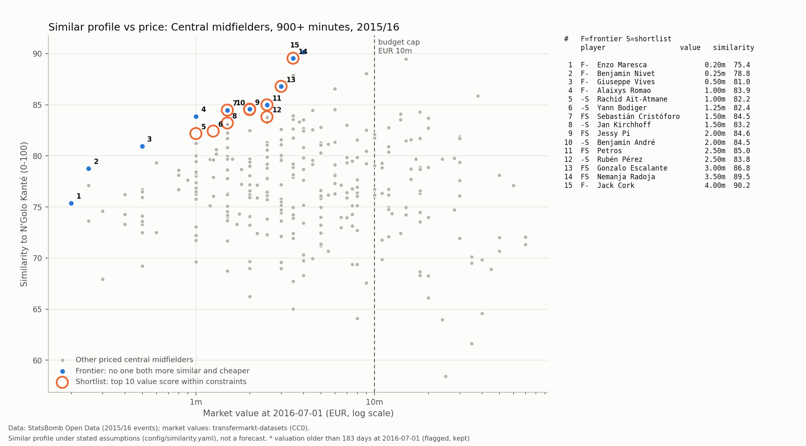
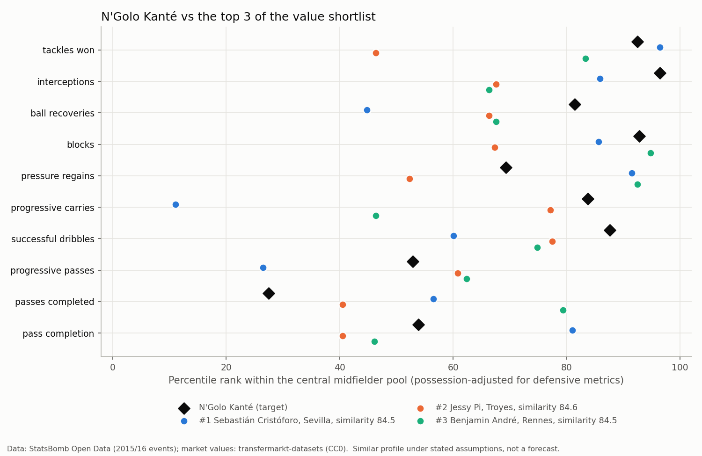

# R4: Similar players, value for money and the shortlist

*Generated by `python -m recruit.run_r4` from `results/r4_shortlist.json`. Do not edit the numbers
by hand.*

Data: StatsBomb Open Data (github.com/hudl/open-data), used under the StatsBomb Public Data User
Agreement, and transfermarkt-datasets (github.com/dcaribou/transfermarkt-datasets, CC0; built from
Transfermarkt, which we do not scrape). This page shows only summaries, never event-level data. The
StatsBomb logo will be added before anything is published (NOTES.md). Market values are
crowd-sourced estimates, not transfer fees.

**How to read this page.** Every list below is a *similar profile under stated assumptions*: which
players' 2015/16 numbers look most like N'Golo Kanté's, given the metrics and weights chosen in
`config/similarity.yaml`. It is not a prediction that anyone would succeed at Leicester. Only 2015/16
matches and market values on or before 2016-07-01 are used.

Settings fingerprint: `config/similarity.yaml` sha256 `554dedea75d9565502e14ffa3e24c30e4bb612d89ee7b87b2df7adb4887fd77b` (written before the first
run on real data and not changed since).

## What this step does, in plain words

1. **Who is compared.** All Central midfielders with at least 900 league minutes in
   2015/16: 307 players including N'Golo Kanté, who is only the target, never a candidate.
2. **What is compared.** 15 numbers (per 90 minutes, plus pass completion) in four groups, each with a weight that reflects what
   N'Golo Kanté contributed (reasons in the config). Defensive numbers are adjusted for team
   possession, so a player in a side that rarely has the ball is not flattered.

| Group | Group weight | Metrics (weight in the distance) |
|---|---:|---|
| Ball-winning | 0.40 | tackles won (0.080), interceptions (0.080), ball recoveries (0.080), blocks (0.080), pressures (0.040), pressure regains (0.040) |
| Progression | 0.30 | progressive carries (0.075), successful dribbles (0.075), progressive passes (0.075), passes into final third (0.075) |
| Passing security | 0.15 | passes completed (0.075), pass completion (0.075) |
| Attacking output | 0.15 | shots (0.050), np xg (0.050), key passes (0.050) |

3. **On one scale.** Each number becomes a z-score within the pool (how many standard deviations above
   or below the pool average), capped at +/-3.00 so one extreme number cannot dominate.
   53 values in the pool were capped; 0 of them
   are N'Golo Kanté's.
4. **Similarity.** The weighted distance between a player's z-scores and N'Golo Kanté's, turned into
   a 0-100 score (100 = identical; 0 = as far apart as the capped scale allows). Distance, not angle:
   a player with half the output in the same proportions is not a replacement. The cosine (profile
   shape regardless of level, 1 = same shape) is shown next to it as a check.
5. **Price.** Transfermarkt market value at 2016-07-01. 306 of the 306
   candidates have one; 0 do not and appear only in the similarity list.
   1 priced candidates have a valuation older than 183 days; they stay in, marked
   "stale value".

## Can the profiles be trusted? Split-half check

Each player's season was cut in two at 2016-01-01. For the 248 pool
players with at least 450 minutes in each half, we took his first-half
profile and asked: among all 248 second-half profiles, where does his own rank?

| Own profile in | Players | Share | By chance |
|---|---:|---:|---:|
| top 1 | 52 | 21.0% | 0.4% |
| top 5 | 121 | 48.8% | 2.0% |

Median rank of a player's own second half: 6.00 out of 248.
N'Golo Kanté's own second half ranks **11** of 248.

**What this says, in plain words.** If profiles were pure noise, a player's own second half would be
the closest match 0.4% of the time and in the top 5 2.0% of the time.
It is the closest 21.0% and in the top 5 48.8% of the time: far above
chance, so the numbers capture something real and repeatable about how each player plays. But it is
far from certain: for the other 51.2% of players, at least five other players' second
halves look more like them than their own does. Half-season profiles rest on half the minutes of the full-season
ones used for the lists below, so the full-season profiles should be steadier, but the lesson holds:
differences of a point or two in similarity between candidates are within the noise. Treat the
shortlist as a group worth scouting, not as an exact order. N'Golo Kanté himself is not perfectly
stable either (rank 11), so any candidate's numbers would also vary from one
half-season to the next. 59 pool players had fewer than
450 minutes in one half and get no split-half rank ("-" in the tables).

## The players most similar to N'Golo Kanté (any price)

| # | Player | Club 2015/16 | League | Age | Minutes | Value (EUR m) | Valued on | Similarity | Cosine | Split-half rank | Similarity rank | Frontier | Meets constraints |
|---:|---|---|---|---:|---:|---:|---|---:|---:|---:|---:|---|---|
| 1 | Jack Cork | Swansea City | Premier League | 27 | 2,737 | 4.00 | 2016-02-09 | 90.17 | 0.83 | 2 | 1 | yes | yes |
| 2 | Nemanja Radoja | Celta Vigo | La Liga | 23 | 1,547 | 3.50 | 2016-02-22 | 89.55 | 0.84 | - | 2 | yes | yes |
| 3 | Asier Illarramendi | Real Sociedad | La Liga | 26 | 2,967 | 15.00 | 2016-02-22 | 89.47 | 0.81 | 2 | 3 |  | no |
| 4 | Idrissa Gueye | Aston Villa | Premier League | 26 | 3,260 | 9.00 | 2016-02-09 | 88.07 | 0.77 | 2 | 4 |  | yes |
| 5 | Pablo Hernández | Celta Vigo | La Liga | 29 | 2,439 | 3.50 | 2016-02-22 | 87.88 | 0.70 | 4 | 5 |  | no |
| 6 | Gonzalo Escalante | Eibar | La Liga | 23 | 2,927 | 3.00 | 2016-02-22 | 86.80 | 0.66 | 2 | 6 | yes | yes |
| 7 | Cheik Tioté | Newcastle United | Premier League | 30 | 1,295 | 6.00 | 2016-02-09 | 86.58 | 0.69 | - | 7 |  | no |
| 8 | Nemanja Matić | Chelsea | Premier League | 27 | 2,636 | 38.00 | 2016-02-09 | 85.88 | 0.59 | 22 | 8 |  | no |
| 9 | Petros | Real Betis | La Liga | 27 | 2,483 | 2.50 | 2016-02-22 | 84.99 | 0.52 | 1 | 9 | yes | yes |
| 10 | Jessy Pi | Troyes | Ligue 1 | 22 | 3,243 | 2.00 | 2016-02-04 | 84.57 | 0.43 | 3 | 10 | yes | yes |

## Value for money

**The frontier (no weights).** A player is on the frontier when nobody else in the pool is at least
as similar *and* at least as cheap (and better on one). 10 players are on it, of whom
6 also meet the shortlist constraints. Cheapest first:

| # | Player | Club 2015/16 | League | Age | Minutes | Value (EUR m) | Valued on | Similarity | Cosine | Split-half rank | Similarity rank | Meets constraints |
|---:|---|---|---|---:|---:|---:|---|---:|---:|---:|---:|---|
| 1 | Enzo Maresca | Palermo | Serie A | 36 | 1,050 | 0.20 | 2016-07-01 | 75.38 | -0.54 | - | 199 | no |
| 2 | Benjamin Nivet | Troyes | Ligue 1 | 39 | 2,459 | 0.25 | 2016-02-04 | 78.77 | -0.32 | 15 | 119 | no |
| 3 | Giuseppe Vives | Torino | Serie A | 35 | 2,719 | 0.50 | 2016-01-04 | 80.96 | 0.09 | 3 | 69 | no |
| 4 | Alaixys Romao | Marseille | Ligue 1 | 32 | 1,373 | 1.00 | 2016-02-04 | 83.86 | 0.47 | 35 | 18 | no |
| 5 | Sebastián Cristóforo | Sevilla | La Liga | 22 | 1,503 | 1.50 | 2016-04-07 | 84.48 | 0.60 | - | 13 | yes |
| 6 | Jessy Pi | Troyes | Ligue 1 | 22 | 3,243 | 2.00 | 2016-02-04 | 84.57 | 0.43 | 3 | 10 | yes |
| 7 | Petros | Real Betis | La Liga | 27 | 2,483 | 2.50 | 2016-02-22 | 84.99 | 0.52 | 1 | 9 | yes |
| 8 | Gonzalo Escalante | Eibar | La Liga | 23 | 2,927 | 3.00 | 2016-02-22 | 86.80 | 0.66 | 2 | 6 | yes |
| 9 | Nemanja Radoja | Celta Vigo | La Liga | 23 | 1,547 | 3.50 | 2016-02-22 | 89.55 | 0.84 | - | 2 | yes |
| 10 | Jack Cork | Swansea City | Premier League | 27 | 2,737 | 4.00 | 2016-02-09 | 90.17 | 0.83 | 2 | 1 | yes |

**The shortlist.** Constraints: market value up to EUR 10.00m (half of N'Golo Kanté's own value
of EUR 20.00m), age 20-28 at 2016-07-01, no Leicester
City players. 134 candidates meet them. The value score is
0.70 x similarity percentile + 0.30 x
cheapness percentile, both among those 134; the top 10:

| # | Player | Club 2015/16 | League | Age | Minutes | Value (EUR m) | Valued on | Similarity | Cosine | Split-half rank | Similarity rank | Value score | Frontier |
|---:|---|---|---|---:|---:|---:|---|---:|---:|---:|---:|---:|---|
| 1 | Sebastián Cristóforo | Sevilla | La Liga | 22 | 1,503 | 1.50 | 2016-04-07 | 84.48 | 0.60 | - | 13 | 89.55 | yes |
| 2 | Jessy Pi | Troyes | Ligue 1 | 22 | 3,243 | 2.00 | 2016-02-04 | 84.57 | 0.43 | 3 | 10 | 87.67 | yes |
| 3 | Benjamin André | Rennes | Ligue 1 | 25 | 2,811 | 2.00 | 2016-02-04 | 84.53 | 0.49 | 9 | 12 | 87.14 |  |
| 4 | Jan Kirchhoff | Sunderland | Premier League | 25 | 1,132 | 1.50 | 2016-02-09 | 83.22 | 0.58 | - | 27 | 86.39 |  |
| 5 | Petros | Real Betis | La Liga | 27 | 2,483 | 2.50 | 2016-02-22 | 84.99 | 0.52 | 1 | 9 | 85.71 | yes |
| 6 | Rachid Aït-Atmane | Sporting Gijón | La Liga | 23 | 1,121 | 1.00 | 2016-02-22 | 82.18 | 0.30 | - | 43 | 85.34 |  |
| 7 | Yann Bodiger | Toulouse | Ligue 1 | 21 | 1,152 | 1.25 | 2016-02-04 | 82.43 | 0.30 | - | 41 | 85.26 |  |
| 8 | Gonzalo Escalante | Eibar | La Liga | 23 | 2,927 | 3.00 | 2016-02-22 | 86.80 | 0.66 | 2 | 6 | 83.76 | yes |
| 9 | Rubén Pérez | Granada | La Liga | 27 | 2,583 | 2.50 | 2016-02-22 | 83.82 | 0.40 | 1 | 19 | 83.08 |  |
| 10 | Nemanja Radoja | Celta Vigo | La Liga | 23 | 1,547 | 3.50 | 2016-02-22 | 89.55 | 0.84 | - | 2 | 82.56 | yes |

5 of the 10 are on the frontier; 4 are also in the top 10 by
similarity; 0 carry a stale valuation. 5 of the 10 have no
split-half rank (under 450 minutes in one half), so their profiles
rest on fewer matches and deserve extra care. "Split-half rank" is where a player's own second half
ranked against his first half (1 = most stable).

Where each shortlisted player differs from N'Golo Kanté (root-mean-square gap per group, in
standard deviations; 0 = identical):

| Player | Ball-winning | Progression | Passing security | Attacking output |
|---|---:|---:|---:|---:|
| Sebastián Cristóforo | 0.92 | 1.12 | 0.74 | 0.68 |
| Jessy Pi | 1.25 | 0.46 | 0.30 | 1.00 |
| Benjamin André | 1.08 | 0.91 | 0.96 | 0.24 |
| Jan Kirchhoff | 0.81 | 0.92 | 1.66 | 0.76 |
| Petros | 1.09 | 1.01 | 0.31 | 0.32 |
| Rachid Aït-Atmane | 1.36 | 0.99 | 0.81 | 0.26 |
| Yann Bodiger | 1.20 | 1.10 | 0.90 | 0.58 |
| Gonzalo Escalante | 0.57 | 0.86 | 1.11 | 0.78 |
| Rubén Pérez | 0.96 | 1.28 | 0.73 | 0.12 |
| Nemanja Radoja | 0.58 | 0.77 | 0.36 | 0.63 |

## Profile comparison

Percentile ranks within the pool (0 = lowest, 1 = highest), possession-adjusted for defensive
metrics:

| Metric | N'Golo Kanté | Sebastián Cristóforo | Jessy Pi | Benjamin André |
|---|---:|---:|---:|---:|
| tackles won | 0.93 | 0.96 | 0.46 | 0.83 |
| interceptions | 0.96 | 0.86 | 0.68 | 0.66 |
| ball recoveries | 0.81 | 0.45 | 0.66 | 0.68 |
| blocks | 0.93 | 0.86 | 0.67 | 0.95 |
| pressure regains | 0.69 | 0.92 | 0.52 | 0.93 |
| progressive carries | 0.84 | 0.11 | 0.77 | 0.46 |
| successful dribbles | 0.88 | 0.60 | 0.78 | 0.75 |
| progressive passes | 0.53 | 0.27 | 0.61 | 0.62 |
| passes completed | 0.28 | 0.56 | 0.41 | 0.79 |
| pass completion | 0.54 | 0.81 | 0.41 | 0.46 |

## What this does not tell us

- Whether a player would fit Leicester's system, team-mates or league; only that his 2015/16
  numbers resemble N'Golo Kanté's under these weights.
- Anything about fitness, character, wages, a club's willingness to sell or the real fee: market
  values are crowd-sourced estimates.
- How much the lists depend on the weights, minutes threshold, valuation date and budget: that is the
  R5 sensitivity analysis.
