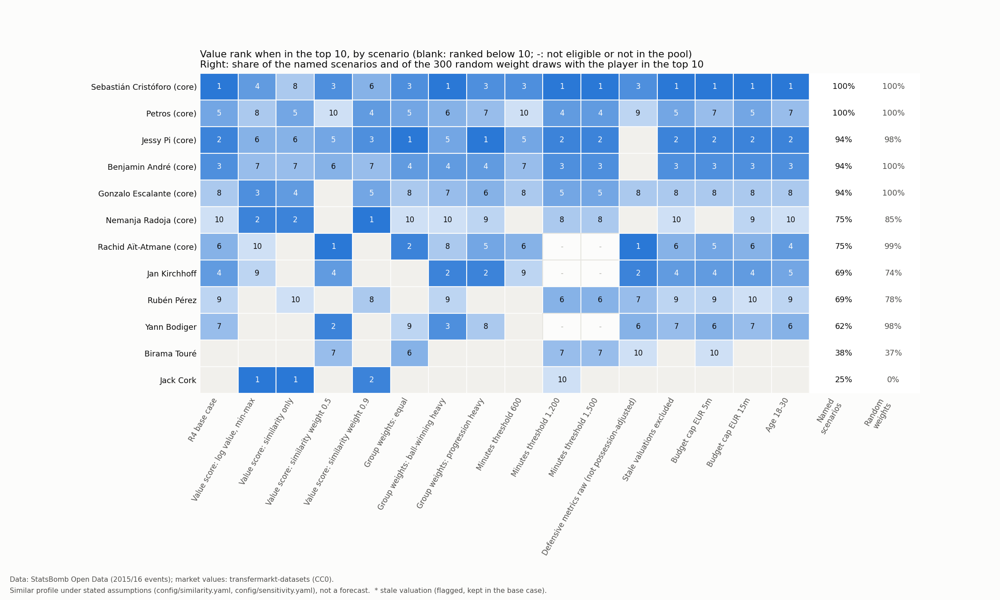
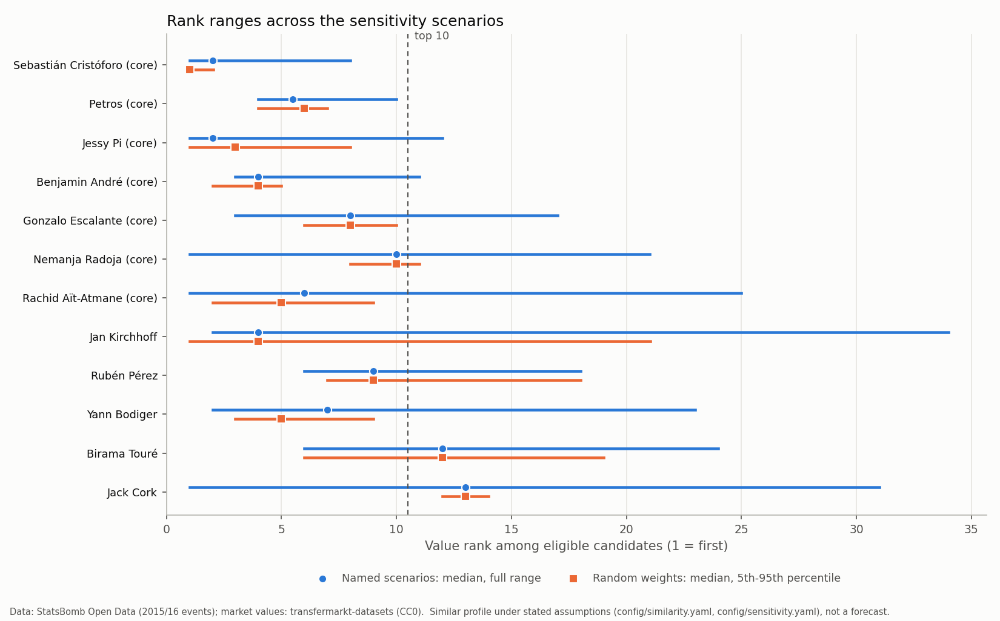

# R5: How much does the shortlist depend on the assumptions?

*Generated by `python -m recruit.run_r5` from `results/r5_sensitivity.json`. Do not edit the numbers
by hand. The full findings report is `docs/REPORT.md`.*

Data: StatsBomb Open Data (github.com/hudl/open-data), used under the StatsBomb Public Data User
Agreement, and transfermarkt-datasets (CC0). Summaries only, never event-level data. StatsBomb logo from the StatsBomb Media Pack (statsbomb.com/media-pack), unchanged. Every list here is a *similar profile under stated assumptions*, not a
forecast.

## In plain words

The R4 shortlist rests on choices: which weights, which minutes threshold, how to mix similarity and
price, which budget. This step reruns the whole analysis 16 times, each time changing
one of those choices, and 300 more times with randomly shaken group weights. A player who
stays in the top 10 under most of them does not owe his place to one particular
assumption. All scenarios, the line for the "robust core" and the rule that picks the recommendation
were written in `config/sensitivity.yaml` before any result was seen.

Fingerprints (sha256): `config/sensitivity.yaml` `376748f06bb6b302e7e7ed0e152c86ce9f6d5c16ecfc7508dc273d462e7ae1b5`;
base `config/similarity.yaml` `554dedea75d9565502e14ffa3e24c30e4bb612d89ee7b87b2df7adb4887fd77b` (the same file as R4; the base
scenario reproduces the R4 shortlist exactly, checked on every run).

## Scenarios

| Scenario (one change from the base) | Pool | Eligible | Top-10 overlap with base | Top 3 by value |
|---|---:|---:|---:|---|
| R4 base case | 307 | 134 | 10 | Sebastián Cristóforo, Jessy Pi, Benjamin André |
| Value score: log value, min-max | 307 | 134 | 8 | Jack Cork, Nemanja Radoja, Gonzalo Escalante |
| Value score: similarity only | 307 | 134 | 7 | Jack Cork, Nemanja Radoja, Idrissa Gueye |
| Value score: similarity weight 0.5 | 307 | 134 | 7 | Rachid Aït-Atmane, Yann Bodiger, Sebastián Cristóforo |
| Value score: similarity weight 0.9 | 307 | 134 | 7 | Nemanja Radoja, Jack Cork, Jessy Pi |
| Group weights: equal | 307 | 134 | 8 | Jessy Pi, Rachid Aït-Atmane, Sebastián Cristóforo |
| Group weights: ball-winning heavy | 307 | 134 | 10 | Sebastián Cristóforo, Jan Kirchhoff, Yann Bodiger |
| Group weights: progression heavy | 307 | 134 | 9 | Jessy Pi, Jan Kirchhoff, Sebastián Cristóforo |
| Minutes threshold 600 | 345 | 161 | 7 | Rafidine Abdullah, Valentin Rongier, Sebastián Cristóforo |
| Minutes threshold 1,200 | 271 | 119 | 7 | Sebastián Cristóforo, Jessy Pi, Benjamin André |
| Minutes threshold 1,500 | 237 | 105 | 7 | Sebastián Cristóforo, Jessy Pi, Benjamin André |
| Defensive metrics raw (not possession-adjusted) | 307 | 134 | 7 | Rachid Aït-Atmane, Jan Kirchhoff, Sebastián Cristóforo |
| Stale valuations excluded | 307 | 133 | 10 | Sebastián Cristóforo, Jessy Pi, Benjamin André |
| Budget cap EUR 5m | 307 | 99 | 9 | Sebastián Cristóforo, Jessy Pi, Benjamin André |
| Budget cap EUR 15m | 307 | 150 | 10 | Sebastián Cristóforo, Jessy Pi, Benjamin André |
| Age 18-30 | 307 | 176 | 10 | Sebastián Cristóforo, Jessy Pi, Benjamin André |

## Robustness of the main candidates

| Player | Robust core | Value (EUR m) | Age | Top 10, scenarios | Top 3, scenarios | Median rank | Rank range | Top 10, random weights | Top 3, random weights | Rank 5th-95th pct, random | Similarity top 10, scenarios |
|---|---|---:|---:|---:|---:|---:|---|---:|---:|---|---:|
| Sebastián Cristóforo | yes | 1.50 | 22 | 100.0% | 81.2% | 2 | 1-8 | 100.0% | 98.7% | 1-2 | 12.5% |
| Petros | yes | 2.50 | 27 | 100.0% | 0.0% | 5.50 | 4-10 | 99.7% | 2.3% | 4-7 | 50.0% |
| Jessy Pi | yes | 2.00 | 22 | 93.8% | 62.5% | 2 | 1-12 | 98.0% | 57.3% | 1-8 | 62.5% |
| Benjamin André | yes | 2.00 | 25 | 93.8% | 43.8% | 4 | 3-11 | 100.0% | 47.3% | 2-5 | 0.0% |
| Gonzalo Escalante | yes | 3.00 | 23 | 93.8% | 6.2% | 8 | 3-17 | 100.0% | 0.0% | 6-10 | 100.0% |
| Nemanja Radoja | yes | 3.50 | 23 | 75.0% | 18.8% | 10 | 1-21 | 85.3% | 0.0% | 8-11 | 100.0% |
| Rachid Aït-Atmane | yes | 1.00 | 23 | 75.0% | 18.8% | 6 | 1-25 | 99.3% | 17.3% | 2-9 | 0.0% |
| Jan Kirchhoff |  | 1.50 | 25 | 68.8% | 18.8% | 4 | 2-34 | 74.0% | 48.3% | 1-21 | 12.5% |
| Rubén Pérez |  | 2.50 | 27 | 68.8% | 0.0% | 9 | 6-18 | 77.7% | 0.0% | 7-18 | 12.5% |
| Yann Bodiger |  | 1.25 | 21 | 62.5% | 12.5% | 7 | 2-23 | 97.7% | 27.0% | 3-9 | 0.0% |
| Birama Touré |  | 1.50 | 24 | 37.5% | 0.0% | 12 | 6-24 | 36.7% | 0.7% | 6-19 | 0.0% |
| Jack Cork |  | 4.00 | 27 | 25.0% | 18.8% | 13 | 1-31 | 0.0% | 0.0% | 12-14 | 100.0% |

**Robust core** (value top 10 in at least 75.0% of
the named scenarios): Sebastián Cristóforo, Jessy Pi, Benjamin André, Nemanja Radoja, Rachid Aït-Atmane, Gonzalo Escalante, Petros.

**Recommendation** (most often in the top 3 among the core; ties by median similarity):
Sebastián Cristóforo. **Backups:** Jessy Pi, Benjamin André.

## Similarity alone

| Player | Value (EUR m) | Age | Similarity top 10, scenarios | Median similarity rank | Range | Similarity top 10, random weights | Value top 10, scenarios |
|---|---:|---:|---:|---:|---|---:|---:|
| Jack Cork | 4.00 | 27 | 100.0% | 1 | 1-8 | 100.0% | 25.0% |
| Nemanja Radoja | 3.50 | 23 | 100.0% | 2 | 2-5 | 100.0% | 75.0% |
| Asier Illarramendi | 15.00 | 26 | 100.0% | 3 | 2-3 | 100.0% | 0.0% |
| Idrissa Gueye | 9.00 | 26 | 100.0% | 4 | 1-7 | 100.0% | 18.8% |
| Gonzalo Escalante | 3.00 | 23 | 100.0% | 6 | 2-10 | 99.7% | 93.8% |
| Pablo Hernández | 3.50 | 29 | 87.5% | 5 | 4-31 | 100.0% | 0.0% |
| Cheik Tioté | 6.00 | 30 | 87.5% | 7 | 4-8 | 96.0% | 0.0% |
| Nemanja Matić | 38.00 | 27 | 75.0% | 8 | 6-45 | 93.0% | 0.0% |
| Jessy Pi | 2.00 | 22 | 62.5% | 10 | 9-24 | 41.3% | 93.8% |
| Petros | 2.50 | 27 | 50.0% | 10 | 6-20 | 58.0% | 100.0% |
| Augusto Fernández | 6.00 | 30 | 25.0% | 11.50 | 10-34 | 30.0% | 0.0% |
| Jaba Kankava | 2.50 | 30 | 25.0% | 20 | 6-32 | 3.0% | 0.0% |
