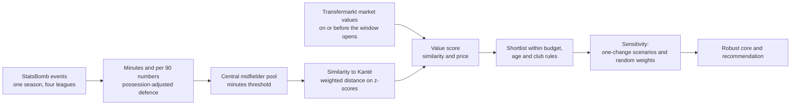
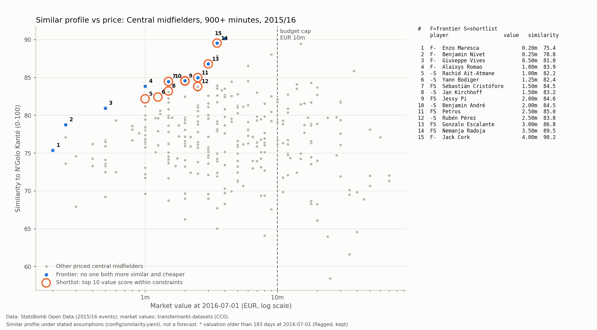
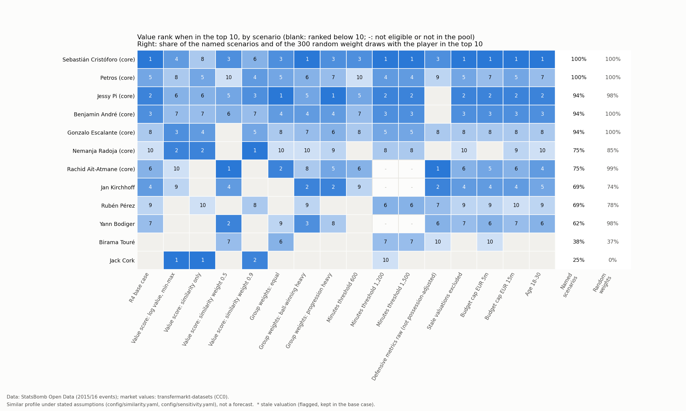
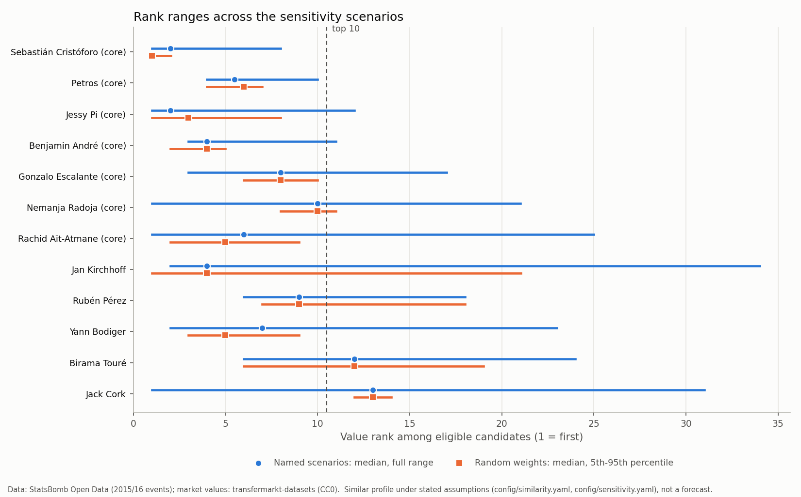

# Replacing N'Golo Kanté on a budget: findings report

*Leicester City, summer transfer window after the 2015/2016 season*

*Generated by `python -m recruit.run_r5` from `results/` (R1-R5). Every number on this page comes from
those files; do not edit numbers by hand.*

**Data credit.** Event data: StatsBomb Open Data (2015/2016 season), used under the StatsBomb Public
Data User Agreement. Market values: transfermarkt-datasets (CC0), a published snapshot built from
Transfermarkt. The StatsBomb logo is added before publication (R6). This report shows summaries only,
never event-level data.

**How to read it.** Every list here describes a *similar profile under stated assumptions*: which
players' 2015/2016 numbers look most like Kanté's, under the metrics, weights and constraints written in
`config/` before the analysis was run. It is not a forecast of how any player would perform at Leicester.
The case is historical: only 2015/2016 match data and market values dated on or before
2016-07-01 are used; nothing that happened after that date is used or mentioned.

---

## Executive summary

- **The problem.** Leicester's ball-winning central midfielder is leaving. Kanté's market value at the
  start of the summer window was EUR 20m. The brief: find players with a similar
  on-pitch contribution for at most EUR 10m, aged 20-28,
  from the 307 central midfielders with 900+ league minutes in
  England, Spain, Italy and France.
- **What he contributed is not in the goal column.** After adjusting for Leicester's low possession,
  Kanté ranked at the 96th percentile of his pool for interceptions,
  93rd for blocks and 92nd for tackles won, and carried the ball
  forward more than most (84th for progressive carries). On shots and
  expected goals he sat at the 24th and 15th percentiles.
- **Recommendation: Sebastián Cristóforo** (Sevilla, 22, market value EUR
  1.50m). Under the pre-set rule he is the robust-core player most often in the value
  top 3: top 10 in 100.0% and top
  3 in 81.2% of 16 one-change
  scenarios, and top 10 in 100.0% of
  300 random weightings.
- **Backups: Jessy Pi** (Troyes, EUR 2m) and **Benjamin André**
  (Rennes, EUR 2m), next by the same rule. 7 players form the
  robust core (value top 10 in at least 12 of
  16 scenarios).
- **The caveat that matters most.** The recommended player wins on price as much as on profile: he is
  13th by similarity alone, and he had too few minutes in one half of the season for the split-half check. The most similar
  profiles inside the constraints (Jack Cork, Nemanja Radoja) are the
  alternative if the club values closeness of profile over price. Scouting, medical, wage and character checks are outside
  this analysis.

---

## The situation

Leicester City won the 2015/2016 Premier League. Their central midfielder N'Golo Kanté played
37 league matches and 3,240 minutes. At the opening of the
summer window his Transfermarkt market value was EUR 20m (valued on
2016-06-01). The question for the recruitment team: which players in Europe's big
leagues did, on the pitch, what Kanté did, and which of them are priced well below him?

The analysis uses one full season of StatsBomb event data for four leagues: every pass, tackle,
interception, carry and shot, with its location.

| League | Teams | Matches | Players who played |
|---|---:|---:|---:|
| Premier League | 20 | 380 | 550 |
| Ligue 1 | 20 | 377 | 574 |
| La Liga | 20 | 380 | 539 |
| Serie A | 20 | 380 | 551 |

In total 1,517 matches and 5,321,459 events. Market values come
from transfermarkt-datasets; 2,175 of 2,176 players who appear in the event
data were matched to a Transfermarkt record (99.95%) and 2,119 have a
valuation on or before 2016-07-01. In Kanté's comparison pool every one of the
307 players is matched and priced.

## What Kanté contributed

Each player-season is described by numbers per 90 minutes. Defensive actions are also adjusted for
possession: a player whose team rarely has the ball gets more chances to tackle and intercept, so the
raw counts are scaled to a common possession level. Leicester had the ball in only
41.8% of the in-play time in Kanté's matches, so his raw defensive numbers are inflated by
that style; the adjusted columns take it out. Percentiles are within the 307 central
midfielders with 900+ minutes (on a 0-100 scale; higher means more of the action).

| Metric (per 90 unless stated) | Raw | Possession-adjusted | Percentile, raw | Percentile, adjusted | Pool median, raw |
|---|---:|---:|---:|---:|---:|
| Tackles won | 2.83 | 2.51 | 98 | 92 | 1.47 |
| Interceptions | 3.06 | 2.65 | 99 | 96 | 1.30 |
| Ball recoveries | 7.50 | 6.62 | 98 | 81 | 5.22 |
| Pressures | 25.16 | 21.91 | 88 | 63 | 19.94 |
| Pressure regains | 3.53 | 3.09 | 90 | 69 | 2.55 |
| Blocks | 3.17 | 2.79 | 97 | 93 | 1.92 |
| Fouls committed | 1.50 | 1.32 | 30 | 20 | 1.77 |
| Passes completed | 33.39 |  | 27 |  | 39.44 |
| Progressive passes | 3.44 |  | 53 |  | 3.38 |
| Passes into the final third | 3.36 |  | 36 |  | 3.96 |
| Progressive carries | 2.19 |  | 84 |  | 1.08 |
| Successful dribbles | 1.33 |  | 88 |  | 0.73 |
| Shots (excl. penalties) | 0.58 |  | 24 |  | 0.89 |
| Non-penalty xG | 0.02 |  | 15 |  | 0.05 |
| Key passes | 0.75 |  | 51 |  | 0.74 |
| Pass completion | 0.82 |  | 54 |  | 0.81 |

Three readings:

1. **Ball-winning is his signature, even after adjustment.** Interceptions fall from the
   99th to the 96th percentile once possession is taken
   into account, tackles won from 98 to 92, ball recoveries
   from 98 to 81. Some of the raw volume was
   Leicester's style, but most of it was him.
2. **He moved the ball forward by carrying, not passing.** Progressive carries
   (84th) and successful dribbles (88th) are
   high; progressive passes (53rd) and passes completed
   (27th) are not. He was not the team's passing hub.
3. **Why goal-based scouting misses him.** Shots (24th), non-penalty xG
   (15th) and key passes (51st) are ordinary or low. A screen built
   on goals, assists or chances created would rank him far down the list; his value sits in actions that
   never reach the score sheet.

## Method in plain language

1. **Who is compared.** Central midfielders (defensive and centre midfield pooled) with at least
   900 league minutes: 307 players. Leicester players are excluded as
   targets.
2. **What is compared.** 15 numbers in four groups, weighted by what Kanté contributed (each weight
   has a written reason in `config/similarity.yaml`):

| Metric group | Weight |
|---|---:|
| Ball winning | 0.40 |
| Progression | 0.30 |
| Passing security | 0.15 |
| Attacking output | 0.15 |

3. **Similarity.** Each number is put on a common scale (how far above or below the pool average, capped
   so one extreme value cannot dominate). Similarity is the weighted distance between a player's numbers
   and Kanté's, shown on a 0-100 scale. Distance rather than shape: a player with half Kanté's output in
   the same proportions is not a replacement.
4. **Value for money.** A value score mixes similarity (0.70) and
   cheapness (0.30) among the 134 players who meet the
   constraints (value up to EUR 10m, age 20-28 at
   2016-07-01, not a Leicester player). A weight-free frontier (no one both more similar and
   cheaper) is shown alongside.
5. **Sensitivity.** Before any results were seen, 16 scenarios that each change one
   assumption and 300 random weightings were written down, together with the line for the
   robust core and the rule that picks the recommendation (`config/sensitivity.yaml`, sha256 starting `376748f06bb6`; base settings sha256 starting
   `554dedea75d9`). The file was amended once after the first run, only to put the displayed rank band
   for the random weightings into config; scenarios, the core line and the rule were not changed
   (PROGRESS.md).

## Similar players and the value view

**Most similar, ignoring price and constraints.** The 10 closest profiles in the pool:

| # | Player | Club 2015/16 | Age | Minutes | Value (EUR m) | Similarity | Similarity rank | Value rank |
|---:|---|---|---:|---:|---:|---:|---:|---:|
| 1 | Jack Cork | Swansea City | 27 | 2,737 | 4.00 | 90.17 | 1 | 13 |
| 2 | Nemanja Radoja | Celta Vigo | 23 | 1,547 | 3.50 | 89.55 | 2 | 10 |
| 3 | Asier Illarramendi | Real Sociedad | 26 | 2,967 | 15.00 | 89.47 | 3 |  |
| 4 | Idrissa Gueye | Aston Villa | 26 | 3,260 | 9.00 | 88.07 | 4 | 28 |
| 5 | Pablo Hernández | Celta Vigo | 29 | 2,439 | 3.50 | 87.88 | 5 |  |
| 6 | Gonzalo Escalante | Eibar | 23 | 2,927 | 3.00 | 86.80 | 6 | 8 |
| 7 | Cheik Tioté | Newcastle United | 30 | 1,295 | 6.00 | 86.58 | 7 |  |
| 8 | Nemanja Matić | Chelsea | 27 | 2,636 | 38.00 | 85.88 | 8 |  |
| 9 | Petros | Real Betis | 27 | 2,483 | 2.50 | 84.99 | 9 | 5 |
| 10 | Jessy Pi | Troyes | 22 | 3,243 | 2.00 | 84.57 | 10 | 2 |

Several of the closest profiles cost more than the cap, are older than the age range, or both. The
value view trades some similarity for price inside the constraints:

| # | Player | Club 2015/16 | Age | Minutes | Value (EUR m) | Similarity | Similarity rank | Value rank | Split-half rank |
|---:|---|---|---:|---:|---:|---:|---:|---:|---:|
| 1 | Sebastián Cristóforo | Sevilla | 22 | 1,503 | 1.50 | 84.48 | 13 | 1 | not rated |
| 2 | Jessy Pi | Troyes | 22 | 3,243 | 2.00 | 84.57 | 10 | 2 | 3 |
| 3 | Benjamin André | Rennes | 25 | 2,811 | 2.00 | 84.53 | 12 | 3 | 9 |
| 4 | Jan Kirchhoff | Sunderland | 25 | 1,132 | 1.50 | 83.22 | 27 | 4 | not rated |
| 5 | Petros | Real Betis | 27 | 2,483 | 2.50 | 84.99 | 9 | 5 | 1 |
| 6 | Rachid Aït-Atmane | Sporting Gijón | 23 | 1,121 | 1.00 | 82.18 | 43 | 6 | not rated |
| 7 | Yann Bodiger | Toulouse | 21 | 1,152 | 1.25 | 82.43 | 41 | 7 | not rated |
| 8 | Gonzalo Escalante | Eibar | 23 | 2,927 | 3.00 | 86.80 | 6 | 8 | 2 |
| 9 | Rubén Pérez | Granada | 27 | 2,583 | 2.50 | 83.82 | 19 | 9 | 1 |
| 10 | Nemanja Radoja | Celta Vigo | 23 | 1,547 | 3.50 | 89.55 | 2 | 10 | not rated |

Only 4 of the 10 shortlisted players are also among the
10 most similar. The value score rewards cheapness through percentile ranks, and many
eligible players are valued at a few million euros or less, so players ranked
41st and 43rd by similarity reach the
shortlist. That is the configured weighting acting as written; the sensitivity section tests it.

*Similarity against market value (log scale). Blue: the frontier; orange rings: the value shortlist.
Source: StatsBomb Open Data; transfermarkt-datasets.*

## Robustness: how much the shortlist depends on the assumptions

### The scenarios

Each scenario changes one thing from the base case and reruns everything downstream of it (pool,
standardisation, similarity, constraints, value score). The table shows each scenario's pool, the number
of eligible players, how many of the base top 10 survive, and the new top
3.

| Scenario (one change from the base) | Pool | Eligible | Top-10 overlap with base | Top 3 by value |
|---|---:|---:|---:|---|
| R4 base case | 307 | 134 | 10 | Sebastián Cristóforo, Jessy Pi, Benjamin André |
| Value score: log value, min-max | 307 | 134 | 8 | Jack Cork, Nemanja Radoja, Gonzalo Escalante |
| Value score: similarity only | 307 | 134 | 7 | Jack Cork, Nemanja Radoja, Idrissa Gueye |
| Value score: similarity weight 0.5 | 307 | 134 | 7 | Rachid Aït-Atmane, Yann Bodiger, Sebastián Cristóforo |
| Value score: similarity weight 0.9 | 307 | 134 | 7 | Nemanja Radoja, Jack Cork, Jessy Pi |
| Group weights: equal | 307 | 134 | 8 | Jessy Pi, Rachid Aït-Atmane, Sebastián Cristóforo |
| Group weights: ball-winning heavy | 307 | 134 | 10 | Sebastián Cristóforo, Jan Kirchhoff, Yann Bodiger |
| Group weights: progression heavy | 307 | 134 | 9 | Jessy Pi, Jan Kirchhoff, Sebastián Cristóforo |
| Minutes threshold 600 | 345 | 161 | 7 | Rafidine Abdullah, Valentin Rongier, Sebastián Cristóforo |
| Minutes threshold 1,200 | 271 | 119 | 7 | Sebastián Cristóforo, Jessy Pi, Benjamin André |
| Minutes threshold 1,500 | 237 | 105 | 7 | Sebastián Cristóforo, Jessy Pi, Benjamin André |
| Defensive metrics raw (not possession-adjusted) | 307 | 134 | 7 | Rachid Aït-Atmane, Jan Kirchhoff, Sebastián Cristóforo |
| Stale valuations excluded | 307 | 133 | 10 | Sebastián Cristóforo, Jessy Pi, Benjamin André |
| Budget cap EUR 5m | 307 | 99 | 9 | Sebastián Cristóforo, Jessy Pi, Benjamin André |
| Budget cap EUR 15m | 307 | 150 | 10 | Sebastián Cristóforo, Jessy Pi, Benjamin André |
| Age 18-30 | 307 | 176 | 10 | Sebastián Cristóforo, Jessy Pi, Benjamin André |

The random weightings draw the four group weights around the base (average ball-winning weight
0.40, standard deviation 0.07, range
0.23 to 0.60), with everything else at the
base case and a fixed seed (20160701).

### Who stays near the top

*Value rank in each scenario when inside the top 10; right-hand columns give the share of
named scenarios and random weightings with the player in the top 10. Source: StatsBomb
Open Data; transfermarkt-datasets.*

| Player | Robust core | Value (EUR m) | Age | Top 10, scenarios | Top 3, scenarios | Median rank | Rank range | Top 10, random weights | Top 3, random weights | Rank 5th-95th pct, random | Similarity top 10, scenarios |
|---|---|---:|---:|---:|---:|---:|---|---:|---:|---|---:|
| Sebastián Cristóforo | yes | 1.50 | 22 | 100.0% | 81.2% | 2 | 1-8 | 100.0% | 98.7% | 1-2 | 12.5% |
| Petros | yes | 2.50 | 27 | 100.0% | 0.0% | 5.50 | 4-10 | 99.7% | 2.3% | 4-7 | 50.0% |
| Jessy Pi | yes | 2.00 | 22 | 93.8% | 62.5% | 2 | 1-12 | 98.0% | 57.3% | 1-8 | 62.5% |
| Benjamin André | yes | 2.00 | 25 | 93.8% | 43.8% | 4 | 3-11 | 100.0% | 47.3% | 2-5 | 0.0% |
| Gonzalo Escalante | yes | 3.00 | 23 | 93.8% | 6.2% | 8 | 3-17 | 100.0% | 0.0% | 6-10 | 100.0% |
| Nemanja Radoja | yes | 3.50 | 23 | 75.0% | 18.8% | 10 | 1-21 | 85.3% | 0.0% | 8-11 | 100.0% |
| Rachid Aït-Atmane | yes | 1.00 | 23 | 75.0% | 18.8% | 6 | 1-25 | 99.3% | 17.3% | 2-9 | 0.0% |
| Jan Kirchhoff |  | 1.50 | 25 | 68.8% | 18.8% | 4 | 2-34 | 74.0% | 48.3% | 1-21 | 12.5% |
| Rubén Pérez |  | 2.50 | 27 | 68.8% | 0.0% | 9 | 6-18 | 77.7% | 0.0% | 7-18 | 12.5% |
| Yann Bodiger |  | 1.25 | 21 | 62.5% | 12.5% | 7 | 2-23 | 97.7% | 27.0% | 3-9 | 0.0% |
| Birama Touré |  | 1.50 | 24 | 37.5% | 0.0% | 12 | 6-24 | 36.7% | 0.7% | 6-19 | 0.0% |
| Jack Cork |  | 4.00 | 27 | 25.0% | 18.8% | 13 | 1-31 | 0.0% | 0.0% | 12-14 | 100.0% |

*Value rank across the named scenarios (median and full range) and the random weightings (median and
5th-95th percentile). Source: StatsBomb Open Data; transfermarkt-datasets.*

**Plain-language reading.** The robust core is Sebastián Cristóforo, Jessy Pi, Benjamin André, Nemanja Radoja, Rachid Aït-Atmane, Gonzalo Escalante, Petros. Changing the weights barely moves the
cheap, reasonably similar players at the head of the list; what moves them is the definition of the value
score, the minutes threshold and the raw-vs-adjusted choice. When price is dropped inside the constraints, or measured on a log scale instead of
by rank, the closer-but-pricier profiles move up. The two views answer different questions, and the club
should decide which it is asking: "who is closest to Kanté that we can afford?" or "who gives the most
Kanté-like profile per euro?".

**The similarity view on its own.** Ranked by similarity alone (no price, no constraints), these players
are in the top 10 in at least 25.0% of the 8 scenarios that
change similarity:

| Player | Value (EUR m) | Age | Similarity top 10, scenarios | Median similarity rank | Range | Similarity top 10, random weights | Value top 10, scenarios |
|---|---:|---:|---:|---:|---|---:|---:|
| Jack Cork | 4.00 | 27 | 100.0% | 1 | 1-8 | 100.0% | 25.0% |
| Nemanja Radoja | 3.50 | 23 | 100.0% | 2 | 2-5 | 100.0% | 75.0% |
| Asier Illarramendi | 15.00 | 26 | 100.0% | 3 | 2-3 | 100.0% | 0.0% |
| Idrissa Gueye | 9.00 | 26 | 100.0% | 4 | 1-7 | 100.0% | 18.8% |
| Gonzalo Escalante | 3.00 | 23 | 100.0% | 6 | 2-10 | 99.7% | 93.8% |
| Pablo Hernández | 3.50 | 29 | 87.5% | 5 | 4-31 | 100.0% | 0.0% |
| Cheik Tioté | 6.00 | 30 | 87.5% | 7 | 4-8 | 96.0% | 0.0% |
| Nemanja Matić | 38.00 | 27 | 75.0% | 8 | 6-45 | 93.0% | 0.0% |
| Jessy Pi | 2.00 | 22 | 62.5% | 10 | 9-24 | 41.3% | 93.8% |
| Petros | 2.50 | 27 | 50.0% | 10 | 6-20 | 58.0% | 100.0% |
| Augusto Fernández | 6.00 | 30 | 25.0% | 11.50 | 10-34 | 30.0% | 0.0% |
| Jaba Kankava | 2.50 | 30 | 25.0% | 20 | 6-32 | 3.0% | 0.0% |

### Are the profiles stable enough to compare?

A split-half check builds each player's profile from the first half of the season (before
2016-01-01) and from the second half, then asks whether his own second-half profile is
the closest match to his first-half one among all 248 players with at least
450 minutes in each half.

| Own second-half profile in the | Players | Share | Expected by chance |
|---|---:|---:|---:|
| top 1 | 52 | 21.0% | 0.4% |
| top 5 | 121 | 48.8% | 2.0% |

A player's own profile is the single closest match 21.0% of the time, against
0.4% by chance, In 48.8% of cases
it is among the 5 closest. Kanté's own second
half ranked 11th. **Reading:** the profiles carry a real signal, far above
chance, but half a season of data is noisy. A gap of a point or two in similarity should not decide
between players; that is why the recommendation rests on how often a player stays near the top across
many assumptions rather than on one ranking. 59 pool players (including
5 of the 10 base shortlist) had too few minutes in one
half to be rated.

## Recommendation and backups

The rule, fixed before the run: among the robust core, the player most often in the value top
3 across the named scenarios is recommended; ties go to the higher median similarity.
The next two are the backups.

|  | Player | Club 2015/16 | League | Age | Minutes | Value (EUR m) | Valued on | Similarity | Similarity rank | Top 10, scenarios | Top 3, scenarios | Top 10, random weights | Split-half rank |
|---|---|---|---|---:|---:|---:|---|---:|---:|---:|---:|---:|---:|
| Recommendation | Sebastián Cristóforo | Sevilla | La Liga | 22 | 1,503 | 1.50 | 2016-04-07 | 84.48 | 13 | 100.0% | 81.2% | 100.0% | not rated |
| Backup 1 | Jessy Pi | Troyes | Ligue 1 | 22 | 3,243 | 2.00 | 2016-02-04 | 84.57 | 10 | 93.8% | 62.5% | 98.0% | 3 |
| Backup 2 | Benjamin André | Rennes | Ligue 1 | 25 | 2,811 | 2.00 | 2016-02-04 | 84.53 | 12 | 93.8% | 43.8% | 100.0% | 9 |

Percentile in the pool on the key metrics (possession-adjusted for defensive ones):

| Key metric (percentile in the pool) | N'Golo Kanté | Sebastián Cristóforo | Jessy Pi | Benjamin André |
|---|---:|---:|---:|---:|
| Tackles won | 92 | 96 | 46 | 83 |
| Interceptions | 96 | 86 | 68 | 66 |
| Ball recoveries | 81 | 45 | 66 | 68 |
| Blocks | 93 | 86 | 67 | 95 |
| Pressure regains | 69 | 92 | 52 | 92 |
| Progressive carries | 84 | 11 | 77 | 46 |
| Successful dribbles | 88 | 60 | 78 | 75 |
| Progressive passes | 53 | 26 | 61 | 62 |
| Passes completed | 28 | 56 | 40 | 79 |
| Pass completion | 54 | 81 | 40 | 46 |

Gap to Kanté per metric group (weighted root-mean-square gap in standard deviations; lower = closer):

| Player | Ball winning | Progression | Passing security | Attacking output |
|---|---:|---:|---:|---:|
| Sebastián Cristóforo | 0.92 | 1.12 | 0.74 | 0.68 |
| Jessy Pi | 1.25 | 0.46 | 0.30 | 1.00 |
| Benjamin André | 1.08 | 0.91 | 0.96 | 0.24 |

**Sebastián Cristóforo (Recommendation).** Sevilla, La Liga, 22 years old,
1,503 league minutes, market value EUR 1.50m (valued
2016-04-07). Similarity 84.48 (13th of
306), value rank 1 in the base case. Trade-offs: below on progressive carries (11 vs 84); below on ball recoveries (45 vs 81); above on passes completed (56 vs 28)
(percentiles, his vs Kanté's). Closest on attacking output, furthest on progression.
Caution: he had too few minutes in one half of the season for the split-half check, so the stability of his
profile is untested, and his 1,503 minutes are only 3 above the
highest threshold tested (1,500). He is in the similarity top 10 in only
12.5% of the scenarios that change similarity: the
recommendation is driven by price as much as by profile.

**Jessy Pi (Backup 1).** Troyes, Ligue 1, 22, 3,243
minutes, EUR 2m. Similarity 84.57 (10th).
Trade-offs: below on tackles won (46 vs 92); below on interceptions (68 vs 96); below on blocks (67 vs 93). Closest on passing security, furthest on
ball winning; his first-half profile found his own second half at rank 3. Top 10 by similarity alone in
62.5% of the similarity scenarios.

**Benjamin André (Backup 2).** Rennes, Ligue 1, 25, 2,811
minutes, EUR 2m. Similarity 84.53 (12th).
Trade-offs: above on passes completed (79 vs 28); below on progressive carries (46 vs 84); below on interceptions (66 vs 96). Closest on attacking output, furthest on
ball winning; his first-half profile found his own second half at rank 9. Top 10 by similarity alone in
0.0% of the similarity scenarios.

**If the club prefers profile to price.** The closest profiles that meet the constraints, in order of
similarity in the base case, are the natural first calls under the "closest we can afford" question:

| Player | Club 2015/16 | Age | Value (EUR m) | Similarity | Similarity rank | Robust core | Value top 10, scenarios | Value top 3, scenarios | Similarity top 10, scenarios |
|---|---|---:|---:|---:|---:|---|---:|---:|---:|
| Jack Cork | Swansea City | 27 | 4.00 | 90.17 | 1 | no | 25.0% | 18.8% | 100.0% |
| Nemanja Radoja | Celta Vigo | 23 | 3.50 | 89.55 | 2 | yes | 75.0% | 18.8% | 100.0% |
| Idrissa Gueye | Aston Villa | 26 | 9.00 | 88.07 | 4 | no | 18.8% | 6.2% | 100.0% |
| Gonzalo Escalante | Eibar | 23 | 3.00 | 86.80 | 6 | yes | 93.8% | 6.2% | 100.0% |
| Petros | Real Betis | 27 | 2.50 | 84.99 | 9 | yes | 100.0% | 0.0% | 50.0% |
| Jessy Pi | Troyes | 22 | 2.00 | 84.57 | 10 | yes | 93.8% | 62.5% | 62.5% |

## Limits

- **One season of event data.** Profiles rest on 2015/2016 only; the split-half check shows that half a
  season is noisy, and a single season is not much more.
- **No tracking or physical data.** Event data records what happened on the ball. Covering ground,
  positioning without the ball and pace are not measured, and they were a large part of Kanté's game.
- **Market value is not a fee or a wage.** Transfermarkt values are crowd-sourced estimates. The actual
  fee depends on contract length, the selling club and competition for the player; wages are not in the
  data at all.
- **Name matching and appearance gaps.** The two sources share no player ID. Matching inside club squads
  reached 99.95%; 1 player (below every minutes threshold) stayed
  unmatched, and 8 players were matched by hand with a written reason, partly
  because Transfermarkt's appearance records have gaps.
- **Possession adjustment is a modelling choice.** The adjustment is linear in the opponent's possession
  share (factors from 0.63 to
  2.49 across team-matches); other forms, for example a sigmoid,
  would shift defensive numbers for teams at the extremes. The raw-metrics scenario shows how much this
  matters for the shortlist.
- **Small samples.** Players near the minutes threshold, and players who could not be rated in the
  split-half check, carry more uncertainty than the similarity score suggests.
- **Other leagues.** Candidates from Spain, Italy and France would be adapting to a different league,
  club and country; the data cannot measure that.
- **Not measured: wages, injuries, character, willingness to move.** All of these decide a transfer.
- **Historical case.** The analysis uses only data available by the opening of the summer window of
  the season studied; nothing after that date is used to choose, tune or describe any player.

## Data sources and terms

- **StatsBomb Open Data** (github.com/hudl/open-data), 2015/2016 season, four leagues. Used under the
  StatsBomb Public Data User Agreement for non-commercial research; no event-level data is published
  here. StatsBomb logo: added in R6.
- **transfermarkt-datasets** (github.com/dcaribou/transfermarkt-datasets), CC0, a published snapshot
  built from Transfermarkt. Nothing was scraped for this project.
- Settings: `config/similarity.yaml`, `config/sensitivity.yaml` and the files they cite. Results:
  `results/r1_data_report.json` to `results/r5_sensitivity.json`. Detail per step: `docs/R1_data_audit.md`
  to `docs/R5_sensitivity.md`.
