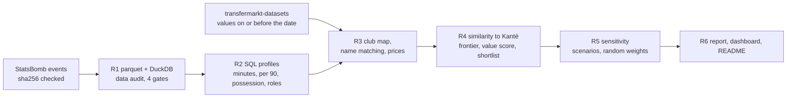

<!-- Generated by `python -m recruit.run_r6` from docs/templates/README.md. Do not edit by hand. -->
# Replacing N'Golo Kanté on a budget (football recruitment, StatsBomb {{season_label}})

{{logo_html}}

A club loses a key starter and has to replace what he did on the pitch for a fraction of his price.
This project takes the real case of **Leicester City losing N'Golo Kanté after the {{season_label}} season**,
builds per 90, possession-adjusted profiles from free StatsBomb event data for that season
(Premier League, La Liga, Serie A, Ligue 1), finds the central midfielders whose profile is closest to
his, prices them with Transfermarkt-derived market values dated no later than {{r1.valuation_date}},
and tests how much the shortlist depends on the assumptions. Every list is a **similar profile under
stated assumptions**, not a forecast of how a player would do at Leicester.

**Read the findings:** [docs/REPORT.md](docs/REPORT.md) · **Explore:** `streamlit run app/streamlit_app.py`
(local only; needs your own StatsBomb download, see Reproduce)

## The case

Leicester won the {{season_label}} Premier League. Kanté played {{r2.departing_player.matches}} league
matches and his market value at the opening of the summer window was EUR {{f.target_value_m}}m. What he
contributed was not in the goal column: after adjusting for Leicester's low possession he ranked at the
{{kpct.interceptions.adj|ord}} percentile of the {{r4.pool.pool}} central midfielders with
{{r4.pool.min_minutes}}+ minutes for interceptions, {{kpct.blocks.adj|ord}} for blocks and
{{kpct.tackles_won.adj|ord}} for tackles won, and {{kpct.progressive_carries.raw|ord}} for progressive
carries, but {{kpct.shots.raw|ord}} for shots. The brief: a similar on-pitch contribution for at most
EUR {{f.cap_m}}m, aged {{r4.settings.age_min}}-{{r4.settings.age_max}}, not a Leicester player.

## Shortlist and recommendation

The value-for-money shortlist (base case: value score = similarity and cheapness, weighted
{{r4.settings.value_weights.similarity}} / {{r4.settings.value_weights.price}}, among the
{{r4.pool.eligible}} players who meet the constraints):

{{table:shortlist}}

**Recommendation: {{picks.0.name}}** ({{picks.0.club}}, {{picks.0.age}}, EUR {{picks.0.value_m}}m), with
**{{picks.1.name}}** and **{{picks.2.name}}** as backups. They come from a rule fixed before any result
was seen: the player in the robust core (below) most often in the value top {{settings.top_k}}.

**Two routes, and the club has to choose.** The recommendation answers "who gives the most Kanté-like
profile per euro?". {{picks.0.name}} wins on price as much as on profile: he is
{{picks.0.similarity_rank|ord}} by similarity alone, and {{picks.0.self_text}}. If the question is "who
is closest to Kanté that we can afford?", the most similar players inside the constraints
({{f.closest_eligible.0.name}}, {{f.closest_eligible.1.name}}) are the first calls. Scouting, medical,
wage and character checks are outside this analysis.

## How it works



| Step | Code | Write-up |
|---|---|---|
| R1 Download, parquet, DuckDB, audit | `src/recruit/run_r1.py`, `sql/r1_*.sql` | [docs/R1_data_audit.md](docs/R1_data_audit.md) |
| R2 Player-season profiles in SQL | `src/recruit/run_r2.py`, `sql/r2_*.sql` | [docs/R2_profiles.md](docs/R2_profiles.md) |
| R3 Market values and name matching | `src/recruit/run_r3.py`, `sql/r3_*.sql` | [docs/R3_market_values.md](docs/R3_market_values.md) |
| R4 Similarity and shortlist | `src/recruit/run_r4.py`, `src/recruit/similarity.py` | [docs/R4_shortlist.md](docs/R4_shortlist.md) |
| R5 Sensitivity and report | `src/recruit/run_r5.py`, `src/recruit/sensitivity.py` | [docs/R5_sensitivity.md](docs/R5_sensitivity.md), [docs/REPORT.md](docs/REPORT.md) |
| R6 Dashboard and README | `app/streamlit_app.py`, `src/recruit/dashboard.py`, `src/recruit/run_r6.py` | this page |

Similarity is a weighted distance between standardised per 90 numbers (z-scores within the pool,
clipped), shown on a fixed 0-100 scale; cosine similarity is reported next to it as a check of profile
shape. The weights favour what Kanté did (ball winning, then progression), each with a written reason in
`config/similarity.yaml`.

## Robustness

The whole analysis was rerun under {{named.scenarios}} one-change scenarios (weights, minutes threshold,
value-score definition, budget, age, raw vs adjusted defence, stale valuations) and {{draws.draws}}
random weightings: {{f.core_size}} players stay in the value top {{settings.top_n}} in at least
{{f.core_line_scenarios}} of the {{named.scenarios}} scenarios, and the recommendation and both backups
are among them. Changing the weights barely moves the head of the list; the definition of the value
score, the minutes threshold and raw vs adjusted defence do, and when price is dropped or log-scaled the
closer but pricier profiles move up.

## Dashboard

`streamlit run app/streamlit_app.py` opens two views. **Case** shows Kanté's profile against his role
pool, the similarity-vs-price chart with the frontier and the shortlist, and the robust core with how
often each player stays near the top:


**Explore** lets you pick any player with {{r4.pool.min_minutes}}+ minutes, see his percentiles within
his role and the most similar players in that role (club, league, age, market value, stale-valuation
flag), and move the group weights, budget cap and age range. It reruns the same tested R4 functions;
with the default settings and Kanté selected it reproduces the R4 lists exactly (tested):


The dashboard is not deployed: the StatsBomb terms do not allow the data to be passed on, so it runs on
your own machine from your own download.

## Reproduce

Recorded on an 8 GB MacBook, Python 3.13 (macOS arm64).

1. **Register with StatsBomb.** The StatsBomb Public Data User Agreement asks users of the open data to
   register at [statsbomb.com/resource-centre](https://statsbomb.com/resource-centre) and to accept its
   terms (non-commercial use, no redistribution, credit with the logo). Do this yourself before
   downloading.
2. **Install and download.** The downloader fetches the published StatsBomb Open Data files from
   github.com/hudl/open-data (season {{season_label}}, four leagues: {{rm.statsbomb_raw_files}} files,
   about {{rm.statsbomb_raw_mb}} MB) and the published transfermarkt-datasets tables
   (about {{rm.transfermarkt_raw_mb}} MB). It resumes if interrupted; nothing is scraped.

```bash
python3 -m venv .venv
.venv/bin/pip install -r requirements.txt && .venv/bin/pip install -e .
.venv/bin/python -m recruit.download
```

3. **Run the steps in order.** R1 checks every raw file against the sha256 fingerprints in
   `config/raw_files.yaml` and stops on any difference (if a source has changed since, re-record with
   `--record` and expect slightly different numbers).

```bash
.venv/bin/python -m recruit.run_r1
.venv/bin/python -m recruit.run_r2
.venv/bin/python -m recruit.run_r3
.venv/bin/python -m recruit.run_r4
.venv/bin/python -m recruit.run_r5
.venv/bin/python -m recruit.run_r6
.venv/bin/python -m pytest
.venv/bin/streamlit run app/streamlit_app.py
```

Recorded run times: R1's flatten step {{rm.seconds.r1_flatten|plain}} s (the download depends on your
connection; R1's load and audit were not timed), R2 {{rm.seconds.r2|plain}} s, R3 {{rm.seconds.r3|plain}} s, R4
{{rm.seconds.r4|plain}} s, R5 {{rm.seconds.r5|plain}} s. The parquet files take about {{rm.parquet_mb}} MB; peak memory
of any step was about {{rm.max_peak_mb}} MB.

## Data, terms and credits

{{logo_html}}

- **StatsBomb Open Data** (github.com/hudl/open-data), {{season_label}} season, used under the StatsBomb
  Public Data User Agreement: research and analysis, non-commercial, no redistribution, published work
  credits StatsBomb with its logo. So `data/raw/` and `data/processed/` are never committed, no
  event-level data appears in any output, and `results/` holds only summaries, shortlists and rankings.
  {{logo_source}}
- **transfermarkt-datasets** (github.com/dcaribou/transfermarkt-datasets), CC0-1.0, a published snapshot
  built by its maintainer from Transfermarkt. Used as published for non-commercial research; this project
  scrapes nothing. Market values are crowd-sourced estimates, not fees or wages.
- **Code:** MIT licence ([LICENSE](LICENSE)). The licence covers the code in this repository only. The
  StatsBomb and Transfermarkt-derived data are not covered by it and are not included.

## Assumptions

All in `config/`, each with a written reason. The base case and what the sensitivity analysis varied:

{{table:assumptions}}

## Limitations

- One season of event data; the split-half check shows that half-season profiles are noisy.
- Event data covers actions on the ball. Ground covered, positioning without the ball and pace are not
  measured, and they were a large part of Kanté's game.
- Market value is the only price signal: not a fee, not a wage.
- The two sources share no player ID; matching inside club squads reached
  {{overall.match_rate|pct2}}, with {{r3.settings.overrides}} players matched by hand with a written
  reason.
- The possession adjustment is a modelling choice (linear in the opponent's share); the raw-metrics
  scenario shows how much it matters.
- Players from other leagues would be adapting to a new league, club and country; the data cannot
  measure that, nor wages, injuries, character or willingness to move.
- Historical case: only data available by {{r1.valuation_date}} is used; nothing that happened later is
  used to choose, tune or describe any player.

## How it was built

I set the questions, scope, case, assumptions and decision rules, and reviewed each milestone before the
next. The code was written with Claude Code, an AI coding assistant, under fixed rules: tests first, no
hand-typed numbers in any document (they are rendered from `results/`), every assumption in `config/`
with a reason, and the sensitivity scenarios and recommendation rule written down before any result was
seen. Decisions and open questions are logged in `NOTES.md`, progress in `PROGRESS.md`.

## Author

{{author}}.
