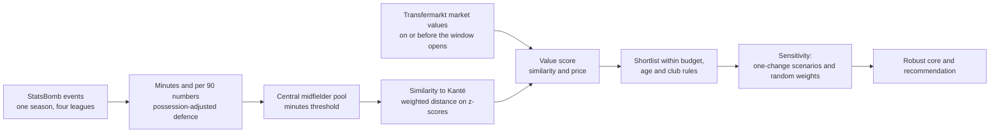

# Replacing N'Golo Kanté on a budget: findings report

*Leicester City, summer transfer window after the {{season}} season*

*Generated by `python -m recruit.run_r5` from `results/` (R1-R5). Every number on this page comes from
those files; do not edit numbers by hand.*

**Data credit.** Event data: StatsBomb Open Data ({{season}} season), used under the StatsBomb Public
Data User Agreement. Market values: transfermarkt-datasets (CC0), a published snapshot built from
Transfermarkt. The StatsBomb logo is added before publication (R6). This report shows summaries only,
never event-level data.

**How to read it.** Every list here describes a *similar profile under stated assumptions*: which
players' {{season}} numbers look most like Kanté's, under the metrics, weights and constraints written in
`config/` before the analysis was run. It is not a forecast of how any player would perform at Leicester.
The case is historical: only {{season}} match data and market values dated on or before
{{r3.valuation_date}} are used; nothing that happened after that date is used or mentioned.

---

## Executive summary

- **The problem.** Leicester's ball-winning central midfielder is leaving. Kanté's market value at the
  start of the summer window was EUR {{f.target_value_m}}m. The brief: find players with a similar
  on-pitch contribution for at most EUR {{f.cap_m}}m, aged {{r4.settings.age_min}}-{{r4.settings.age_max}},
  from the {{r4.pool.pool}} central midfielders with {{r4.pool.min_minutes}}+ league minutes in
  England, Spain, Italy and France.
- **What he contributed is not in the goal column.** After adjusting for Leicester's low possession,
  Kanté ranked at the {{kpct.interceptions.adj|ord}} percentile of his pool for interceptions,
  {{kpct.blocks.adj|ord}} for blocks and {{kpct.tackles_won.adj|ord}} for tackles won, and carried the ball
  forward more than most ({{kpct.progressive_carries.raw|ord}} for progressive carries). On shots and
  expected goals he sat at the {{kpct.shots.raw|ord}} and {{kpct.np_xg.raw|ord}} percentiles.
- **Recommendation: {{picks.0.name}}** ({{picks.0.club}}, {{picks.0.age}}, market value EUR
  {{picks.0.value_m}}m). Under the pre-set rule he is the robust-core player most often in the value
  top {{settings.top_k}}: top {{settings.top_n}} in {{picks.0.value_named.share_top_n|pct}} and top
  {{settings.top_k}} in {{picks.0.value_named.share_top_k|pct}} of {{named.scenarios}} one-change
  scenarios, and top {{settings.top_n}} in {{picks.0.value_draws.share_top_n|pct}} of
  {{draws.draws}} random weightings.
- **Backups: {{picks.1.name}}** ({{picks.1.club}}, EUR {{picks.1.value_m}}m) and **{{picks.2.name}}**
  ({{picks.2.club}}, EUR {{picks.2.value_m}}m), next by the same rule. {{f.core_size}} players form the
  robust core (value top {{settings.top_n}} in at least {{f.core_line_scenarios}} of
  {{named.scenarios}} scenarios).
- **The caveat that matters most.** The recommended player wins on price as much as on profile: he is
  {{picks.0.similarity_rank|ord}} by similarity alone, and {{picks.0.self_text}}. The most similar
  profiles inside the constraints ({{f.closest_eligible.0.name}}, {{f.closest_eligible.1.name}}) are the
  alternative if the club values closeness of profile over price. Scouting, medical, wage and character checks are outside
  this analysis.

---

## The situation

Leicester City won the {{season}} Premier League. Their central midfielder N'Golo Kanté played
{{r2.departing_player.matches}} league matches and {{r4.target.minutes}} minutes. At the opening of the
summer window his Transfermarkt market value was EUR {{f.target_value_m}}m (valued on
{{r4.target.valuation_date}}). The question for the recruitment team: which players in Europe's big
leagues did, on the pitch, what Kanté did, and which of them are priced well below him?

The analysis uses one full season of StatsBomb event data for four leagues: every pass, tackle,
interception, carry and shot, with its location.

{{table:leagues}}

In total {{r1.row_counts.sb_matches}} matches and {{r1.row_counts.sb_events}} events. Market values come
from transfermarkt-datasets; {{overall.matched}} of {{overall.players}} players who appear in the event
data were matched to a Transfermarkt record ({{overall.match_rate|pct2}}) and {{overall.priced}} have a
valuation on or before {{r3.valuation_date}}. In Kanté's comparison pool every one of the
{{r3.focus_pool.players}} players is matched and priced.

## What Kanté contributed

Each player-season is described by numbers per 90 minutes. Defensive actions are also adjusted for
possession: a player whose team rarely has the ball gets more chances to tackle and intercept, so the
raw counts are scaled to a common possession level. Leicester had the ball in only
{{team_share|pct}} of the in-play time in Kanté's matches, so his raw defensive numbers are inflated by
that style; the adjusted columns take it out. Percentiles are within the {{r4.pool.pool}} central
midfielders with {{r4.pool.min_minutes}}+ minutes (on a 0-100 scale; higher means more of the action).

{{table:kante_profile}}

Three readings:

1. **Ball-winning is his signature, even after adjustment.** Interceptions fall from the
   {{kpct.interceptions.raw|ord}} to the {{kpct.interceptions.adj|ord}} percentile once possession is taken
   into account, tackles won from {{kpct.tackles_won.raw}} to {{kpct.tackles_won.adj}}, ball recoveries
   from {{kpct.ball_recoveries.raw}} to {{kpct.ball_recoveries.adj}}. Some of the raw volume was
   Leicester's style, but most of it was him.
2. **He moved the ball forward by carrying, not passing.** Progressive carries
   ({{kpct.progressive_carries.raw|ord}}) and successful dribbles ({{kpct.successful_dribbles.raw|ord}}) are
   high; progressive passes ({{kpct.progressive_passes.raw|ord}}) and passes completed
   ({{kpct.passes_completed.raw|ord}}) are not. He was not the team's passing hub.
3. **Why goal-based scouting misses him.** Shots ({{kpct.shots.raw|ord}}), non-penalty xG
   ({{kpct.np_xg.raw|ord}}) and key passes ({{kpct.key_passes.raw|ord}}) are ordinary or low. A screen built
   on goals, assists or chances created would rank him far down the list; his value sits in actions that
   never reach the score sheet.

## Method in plain language

1. **Who is compared.** Central midfielders (defensive and centre midfield pooled) with at least
   {{r4.pool.min_minutes}} league minutes: {{r4.pool.pool}} players. Leicester players are excluded as
   targets.
2. **What is compared.** {{f.n_metrics}} numbers in four groups, weighted by what Kanté contributed (each weight
   has a written reason in `config/similarity.yaml`):

{{table:weights}}

3. **Similarity.** Each number is put on a common scale (how far above or below the pool average, capped
   so one extreme value cannot dominate). Similarity is the weighted distance between a player's numbers
   and Kanté's, shown on a 0-100 scale. Distance rather than shape: a player with half Kanté's output in
   the same proportions is not a replacement.
4. **Value for money.** A value score mixes similarity ({{r4.settings.value_weights.similarity}}) and
   cheapness ({{r4.settings.value_weights.price}}) among the {{r4.pool.eligible}} players who meet the
   constraints (value up to EUR {{f.cap_m}}m, age {{r4.settings.age_min}}-{{r4.settings.age_max}} at
   {{r3.valuation_date}}, not a Leicester player). A weight-free frontier (no one both more similar and
   cheaper) is shown alongside.
5. **Sensitivity.** Before any results were seen, {{named.scenarios}} scenarios that each change one
   assumption and {{draws.draws}} random weightings were written down, together with the line for the
   robust core and the rule that picks the recommendation (`config/sensitivity.yaml`, sha256 starting `{{fp_short}}`; base settings sha256 starting
   `{{sim_fp_short}}`). The file was amended once after the first run, only to put the displayed rank band
   for the random weightings into config; scenarios, the core line and the rule were not changed
   (PROGRESS.md).

## Similar players and the value view

**Most similar, ignoring price and constraints.** The {{settings.top_n}} closest profiles in the pool:

{{table:top_similar}}

Several of the closest profiles cost more than the cap, are older than the age range, or both. The
value view trades some similarity for price inside the constraints:

{{table:shortlist}}

Only {{f.r4_shortlist_in_top_similar}} of the {{settings.top_n}} shortlisted players are also among the
{{settings.top_n}} most similar. The value score rewards cheapness through percentile ranks, and many
eligible players are valued at a few million euros or less, so players ranked
{{r4.shortlist.6.similarity_rank|ord}} and {{r4.shortlist.5.similarity_rank|ord}} by similarity reach the
shortlist. That is the configured weighting acting as written; the sensitivity section tests it.

*Similarity against market value (log scale). Blue: the frontier; orange rings: the value shortlist.
Source: StatsBomb Open Data; transfermarkt-datasets.*

## Robustness: how much the shortlist depends on the assumptions

### The scenarios

Each scenario changes one thing from the base case and reruns everything downstream of it (pool,
standardisation, similarity, constraints, value score). The table shows each scenario's pool, the number
of eligible players, how many of the base top {{settings.top_n}} survive, and the new top
{{settings.top_k}}.

{{table:scenarios}}

The random weightings draw the four group weights around the base (average ball-winning weight
{{draws.weights.ball_winning.mean}}, standard deviation {{draws.weights.ball_winning.sd}}, range
{{draws.weights.ball_winning.min}} to {{draws.weights.ball_winning.max}}), with everything else at the
base case and a fixed seed ({{draws.seed|plain}}).

### Who stays near the top

*Value rank in each scenario when inside the top {{settings.top_n}}; right-hand columns give the share of
named scenarios and random weightings with the player in the top {{settings.top_n}}. Source: StatsBomb
Open Data; transfermarkt-datasets.*

{{table:robust}}

*Value rank across the named scenarios (median and full range) and the random weightings (median and
{{f.q_lo|ord}}-{{f.q_hi|ord}} percentile). Source: StatsBomb Open Data; transfermarkt-datasets.*

**Plain-language reading.** The robust core is {{core_list}}. Changing the weights barely moves the
cheap, reasonably similar players at the head of the list; what moves them is the definition of the value
score, the minutes threshold and the raw-vs-adjusted choice. When price is dropped inside the constraints, or measured on a log scale instead of
by rank, the closer-but-pricier profiles move up. The two views answer different questions, and the club
should decide which it is asking: "who is closest to Kanté that we can afford?" or "who gives the most
Kanté-like profile per euro?".

**The similarity view on its own.** Ranked by similarity alone (no price, no constraints), these players
are in the top {{settings.top_n}} in at least {{settings.figure_min_share|pct}} of the {{named.similarity_view}} scenarios that
change similarity:

{{table:similarity_view}}

### Are the profiles stable enough to compare?

A split-half check builds each player's profile from the first half of the season (before
{{r4.stability.split_date}}) and from the second half, then asks whether his own second-half profile is
the closest match to his first-half one among all {{r4.stability.players}} players with at least
{{r4.stability.min_minutes_per_half}} minutes in each half.

{{table:stability}}

A player's own profile is the single closest match {{top1.share|pct}} of the time, against
{{top1.chance|pct}} by chance, In {{top5.share|pct}} of cases
it is among the {{top5.k}} closest. Kanté's own second
half ranked {{r4.stability.target_rank|ord}}. **Reading:** the profiles carry a real signal, far above
chance, but half a season of data is noisy. A gap of a point or two in similarity should not decide
between players; that is why the recommendation rests on how often a player stays near the top across
many assumptions rather than on one ranking. {{stab_not_rated}} pool players (including
{{f.r4_shortlist_no_split_half}} of the {{settings.top_n}} base shortlist) had too few minutes in one
half to be rated.

## Recommendation and backups

The rule, fixed before the run: among the robust core, the player most often in the value top
{{settings.top_k}} across the named scenarios is recommended; ties go to the higher median similarity.
The next two are the backups.

{{table:picks}}

Percentile in the pool on the key metrics (possession-adjusted for defensive ones):

{{table:picks_pct}}

Gap to Kanté per metric group (weighted root-mean-square gap in standard deviations; lower = closer):

{{table:picks_gaps}}

**{{picks.0.name}} ({{picks.0.role}}).** {{picks.0.club}}, {{picks.0.league}}, {{picks.0.age}} years old,
{{picks.0.minutes}} league minutes, market value EUR {{picks.0.value_m}}m (valued
{{picks.0.valuation_date}}). Similarity {{picks.0.similarity}} ({{picks.0.similarity_rank|ord}} of
{{r4.pool.candidates}}), value rank {{picks.0.value_rank}} in the base case. Trade-offs: {{picks.0.tradeoff_text}}
(percentiles, his vs Kanté's). Closest on {{picks.0.smallest_gap}}, furthest on {{picks.0.largest_gap}}.
Caution: {{picks.0.self_text}}, so the stability of his
profile is untested, and his {{picks.0.minutes}} minutes are only {{f.picks.0.minutes_above_max_threshold}} above the
highest threshold tested ({{f.max_minutes_threshold}}). He is in the similarity top {{settings.top_n}} in only
{{picks.0.similarity_named.share_top_n|pct}} of the scenarios that change similarity: the
recommendation is driven by price as much as by profile.

**{{picks.1.name}} ({{picks.1.role}}).** {{picks.1.club}}, {{picks.1.league}}, {{picks.1.age}}, {{picks.1.minutes}}
minutes, EUR {{picks.1.value_m}}m. Similarity {{picks.1.similarity}} ({{picks.1.similarity_rank|ord}}).
Trade-offs: {{picks.1.tradeoff_text}}. Closest on {{picks.1.smallest_gap}}, furthest on
{{picks.1.largest_gap}}; {{picks.1.self_text}}. Top {{settings.top_n}} by similarity alone in
{{picks.1.similarity_named.share_top_n|pct}} of the similarity scenarios.

**{{picks.2.name}} ({{picks.2.role}}).** {{picks.2.club}}, {{picks.2.league}}, {{picks.2.age}}, {{picks.2.minutes}}
minutes, EUR {{picks.2.value_m}}m. Similarity {{picks.2.similarity}} ({{picks.2.similarity_rank|ord}}).
Trade-offs: {{picks.2.tradeoff_text}}. Closest on {{picks.2.smallest_gap}}, furthest on
{{picks.2.largest_gap}}; {{picks.2.self_text}}. Top {{settings.top_n}} by similarity alone in
{{picks.2.similarity_named.share_top_n|pct}} of the similarity scenarios.

**If the club prefers profile to price.** The closest profiles that meet the constraints, in order of
similarity in the base case, are the natural first calls under the "closest we can afford" question:

{{table:closest_eligible}}

## Limits

- **One season of event data.** Profiles rest on {{season}} only; the split-half check shows that half a
  season is noisy, and a single season is not much more.
- **No tracking or physical data.** Event data records what happened on the ball. Covering ground,
  positioning without the ball and pace are not measured, and they were a large part of Kanté's game.
- **Market value is not a fee or a wage.** Transfermarkt values are crowd-sourced estimates. The actual
  fee depends on contract length, the selling club and competition for the player; wages are not in the
  data at all.
- **Name matching and appearance gaps.** The two sources share no player ID. Matching inside club squads
  reached {{overall.match_rate|pct2}}; {{unmatched}} player (below every minutes threshold) stayed
  unmatched, and {{r3.settings.overrides}} players were matched by hand with a written reason, partly
  because Transfermarkt's appearance records have gaps.
- **Possession adjustment is a modelling choice.** The adjustment is linear in the opponent's possession
  share (factors from {{r2.possession_check.adjustment_factor_min}} to
  {{r2.possession_check.adjustment_factor_max}} across team-matches); other forms, for example a sigmoid,
  would shift defensive numbers for teams at the extremes. The raw-metrics scenario shows how much this
  matters for the shortlist.
- **Small samples.** Players near the minutes threshold, and players who could not be rated in the
  split-half check, carry more uncertainty than the similarity score suggests.
- **Other leagues.** Candidates from Spain, Italy and France would be adapting to a different league,
  club and country; the data cannot measure that.
- **Not measured: wages, injuries, character, willingness to move.** All of these decide a transfer.
- **Historical case.** The analysis uses only data available by the opening of the summer window of
  the season studied; nothing after that date is used to choose, tune or describe any player.

## Data sources and terms

- **StatsBomb Open Data** (github.com/hudl/open-data), {{season}} season, four leagues. Used under the
  StatsBomb Public Data User Agreement for non-commercial research; no event-level data is published
  here. StatsBomb logo: added in R6.
- **transfermarkt-datasets** (github.com/dcaribou/transfermarkt-datasets), CC0, a published snapshot
  built from Transfermarkt. Nothing was scraped for this project.
- Settings: `config/similarity.yaml`, `config/sensitivity.yaml` and the files they cite. Results:
  `results/r1_data_report.json` to `results/r5_sensitivity.json`. Detail per step: `docs/R1_data_audit.md`
  to `docs/R5_sensitivity.md`.
